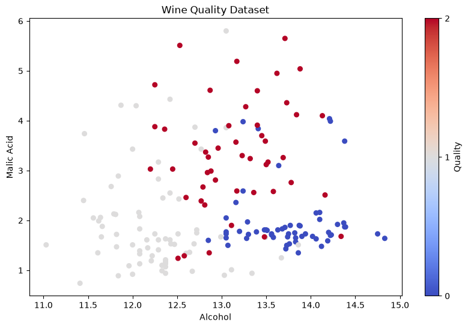
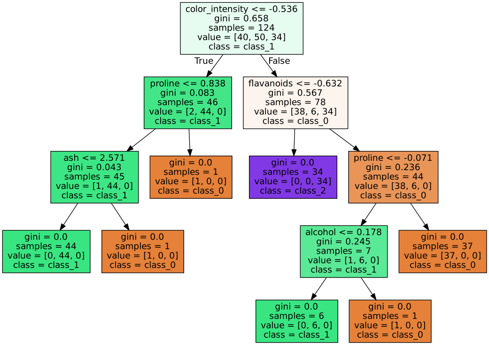
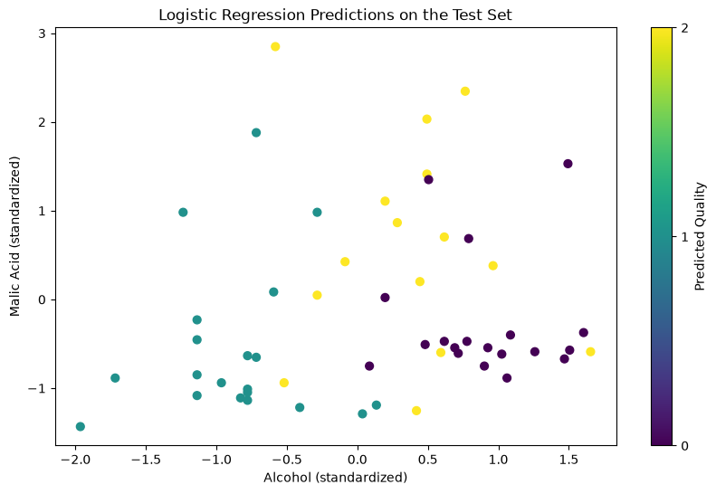
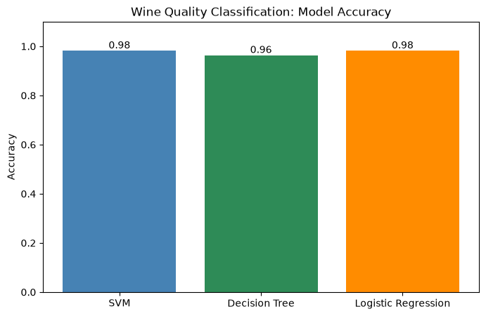

# NANO 706 · Assignment 2, Part 1: Wine Classification

**Student:** Bukola Akindipe
**Notebook:** [`Nano706_Homework2_part1_Bukola.ipynb`](Nano706_Homework2_part1_Bukola.ipynb)

## Task

Use the Wine dataset to visualize the data, split it into training and testing sets, and train a **Decision Tree** and a **Logistic Regression** model, using the SVM code from class as the example.

## Dataset

The scikit-learn Wine dataset: 178 wine samples, 13 chemical features (alcohol, malic acid, flavanoids, proline, color intensity, etc.), and 3 classes (0, 1, 2). The features were standardized with `StandardScaler` before training.

## 1. Data Visualization



Even with just alcohol and malic acid, the classes separate fairly well. Class 0 has high alcohol and low malic acid, class 1 has low alcohol, and class 2 has the highest malic acid.

## 2. Train/Test Split

```python
X_train, X_test, y_train, y_test = train_test_split(X2, y, test_size=0.3, random_state=42)
```

This gives 124 training samples and 54 testing samples.

## 3. Decision Tree

```python
tree = DecisionTreeClassifier(random_state=42)
tree.fit(X_train, y_train)
y_pred_tree = tree.predict(X_test)
accuracy_tree = accuracy_score(y_test, y_pred_tree)
```

**Accuracy: 0.96** (2 of 54 test samples misclassified)



The tree splits first on color intensity, then on proline and flavanoids, so these are the most useful features for telling the classes apart. A few branches end with only 1 sample, which is a sign of slight overfitting.

## 4. Logistic Regression

```python
log_regressor = LogisticRegression(max_iter=200)
log_regressor.fit(X_train, y_train)
y_pred_log = log_regressor.predict(X_test)
accuracy_log = accuracy_score(y_test, y_pred_log)
```

**Accuracy: 0.98** (1 of 54 test samples misclassified)



The predicted classes follow the same pattern as the raw data, which shows the model picked up real chemical differences between the classes.

## 5. Comparison



| Model | Accuracy |
|---|---|
| SVM (class example) | 0.98 |
| Decision Tree | 0.96 |
| Logistic Regression | 0.98 |

## Conclusion

All three models classify the wines very well. Logistic Regression matched the SVM at 0.98. The Decision Tree came in slightly lower at 0.96, most likely because it overfits the training data a little. With only 54 test samples, one misclassified wine changes accuracy by about 2%, so the models perform very similarly.

## How to Run

Open the notebook in Google Colab or Jupyter and run all cells. The Wine dataset loads directly from scikit-learn.
