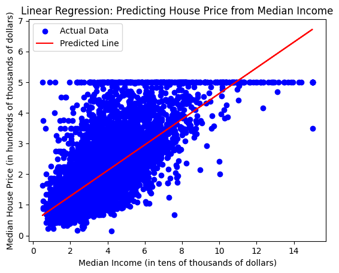
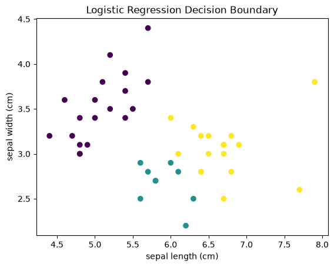
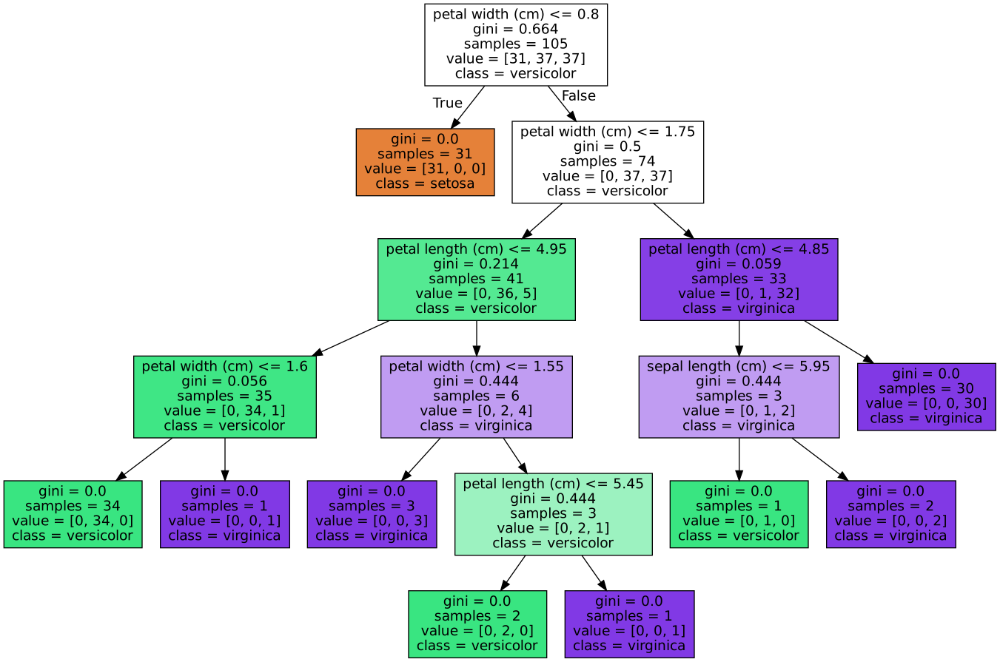
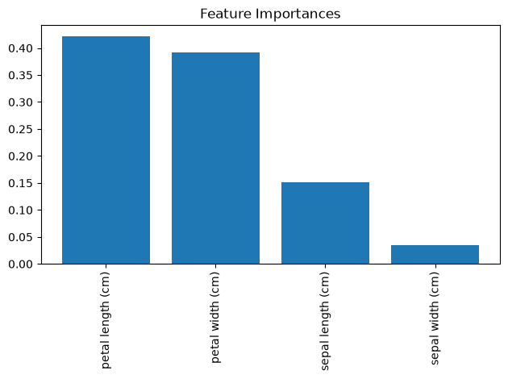
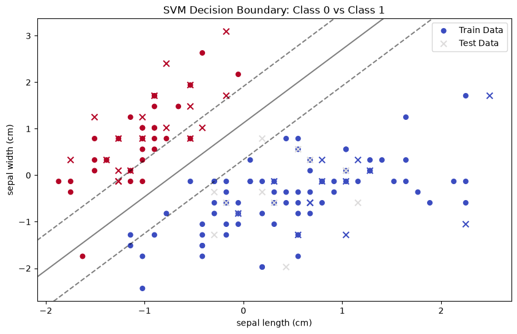
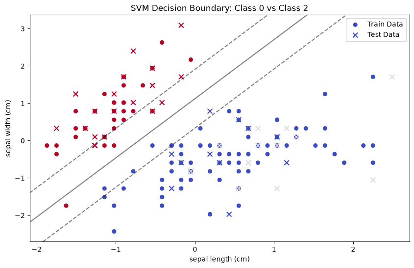
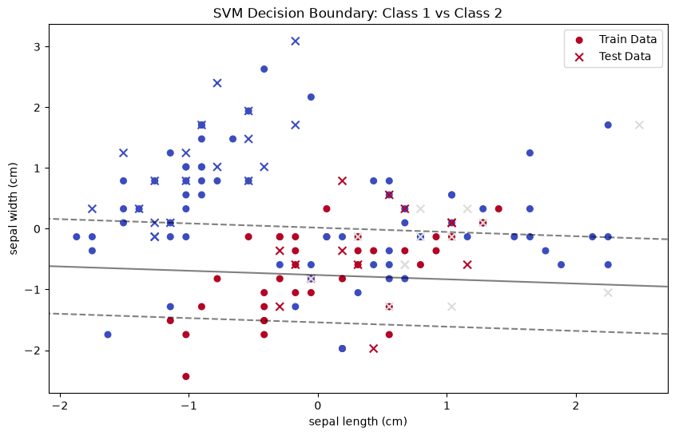
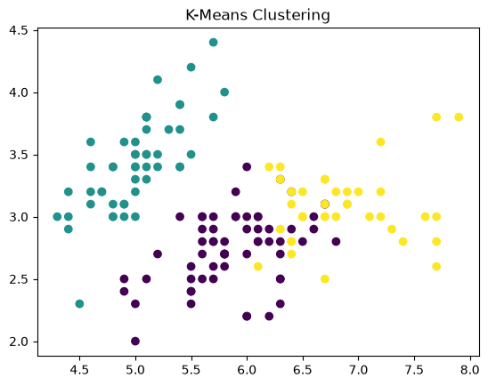
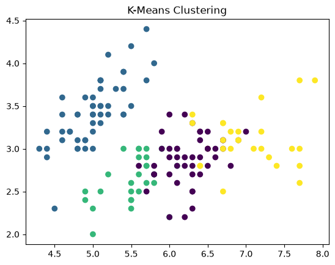
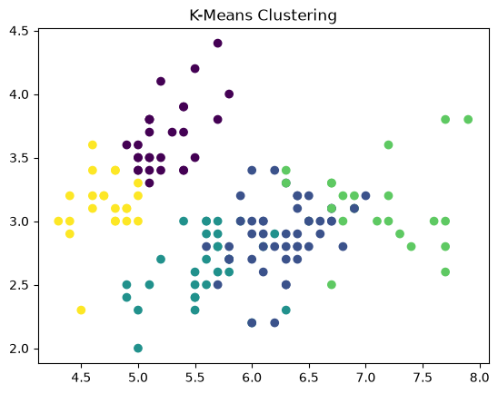

# NANO 706 · Assignment 2, Part 1: Machine Learning for Modeling Biological Systems

**Course:** NANO 706, Systems and Computational Biology (JSNN, NC A&T)
**Instructor:** Dr. Samuel Oliveira
**Student:** Bukola Akindipe
**Assignment:** #2, Exercise 1 (AI for Modeling Molecular Reactions, Biological Systems, Mechanisms, its Regulation, Cell Growth)
**Notebook:** [`Nano706_Homework2_part1_Bukola.ipynb`](Nano706_Homework2_part1_Bukola.ipynb)

---

## Table of Contents

1. [Overview](#overview)
2. [Repository Structure](#repository-structure)
3. [How to Run](#how-to-run)
4. [Part A: Class Exercises (Iris and California Housing)](#part-a-class-exercises)
   - [Linear Regression](#1-linear-regression)
   - [Logistic Regression](#2-logistic-regression)
   - [Decision Tree](#3-decision-tree)
   - [Random Forest](#4-random-forest)
   - [Support Vector Machine](#5-support-vector-machine-svm)
   - [Neural Network (MLP)](#6-neural-network-mlp)
   - [K-Means Clustering](#7-k-means-clustering-unsupervised)
5. [Part B: Homework on a New Dataset (Wine)](#part-b-homework-on-a-new-dataset-wine)
6. [Results Summary](#results-summary)
7. [Interpretation and Discussion](#interpretation-and-discussion)
8. [Limitations and Notes](#limitations-and-notes)
9. [What I Learned](#what-i-learned)
10. [References](#references)

---

## Overview

In this assignment I used the machine learning scripts from class to model and classify biological and real-world data. The work has two parts:

- **Part A (class exercises):** I ran the in-class code for the main supervised learning algorithms (linear regression, logistic regression, decision tree, random forest, SVM, neural network) and one unsupervised algorithm (K-means clustering), mostly on the **Iris** flower dataset.
- **Part B (homework):** I applied the same code to a **new dataset**, the **Wine** dataset, and completed the missing parts: data visualization, train/test splitting, and training a **Decision Tree** and a **Logistic Regression** classifier, using the SVM example as a template. I then compared all three models and added new plots to help interpret the results.

The goal was to understand how each algorithm learns from data, how to evaluate it, and how visualization helps explain what a model is doing.

---

## Repository Structure

```
.
├── Nano706_Homework2_part1_Bukola.ipynb   # Full notebook with code, comments and outputs
├── README.md                              # This report (results, plots, interpretation)
└── figures/                               # All plots generated by the notebook
    ├── 01_linear_regression_housing.png
    ├── 02_logistic_regression_iris.png
    ├── 03_iris_decision_tree.png
    ├── 04_random_forest_feature_importance.png
    ├── 05_svm_setosa_vs_versicolor.png
    ├── 06_svm_setosa_vs_virginica.png
    ├── 07_svm_versicolor_vs_virginica.png
    ├── 08_kmeans_k3.png
    ├── 09_kmeans_k4.png
    ├── 10_kmeans_k5.png
    ├── 11_wine_dataset_scatter.png
    ├── 12_wine_decision_tree.png
    ├── 13_wine_logistic_regression_predictions.png
    └── 14_wine_model_comparison.png
```

---

## How to Run

The notebook runs in **Google Colab** or any local Jupyter environment.

**Requirements**

```bash
pip install numpy pandas matplotlib seaborn scikit-learn graphviz pydot
```

The decision tree diagrams also need the Graphviz system package (`apt install graphviz` on Linux, `brew install graphviz` on macOS). Colab already has it.

**Steps**

1. Open `Nano706_Homework2_part1_Bukola.ipynb`.
2. Run all cells from top to bottom (`Runtime → Run all` in Colab).
3. All datasets load directly from `scikit-learn`, so no files need to be downloaded by hand. The California Housing dataset is downloaded automatically the first time.

---

## Part A: Class Exercises

Most of the class exercises use the **Iris dataset**: 150 flowers from 3 species (*setosa*, *versicolor*, *virginica*), each described by 4 measurements: sepal length, sepal width, petal length and petal width. The data is split into **70% training and 30% testing** (`random_state=42`) so the models are always evaluated on flowers they have never seen.

### 1. Linear Regression

**What it does:** fits a straight line that best predicts a continuous output from an input.
**Data:** California Housing dataset. Input = median income of a district; output = median house price.



**Interpretation:** the red line shows a clear positive trend: districts with higher median income have higher house prices. The spread of the blue points around the line is large, so income alone explains only part of the price. The horizontal band of points at the top is a **cap in the dataset** (prices above $500,000 were recorded as $500,000), which a straight line cannot capture. Adding more features (location, house age, rooms) would improve the model.

### 2. Logistic Regression

**What it does:** predicts which class a sample belongs to by turning a linear score into a probability with a sigmoid function.
**Data:** Iris, using only the first two features (sepal length and sepal width) so the result can be plotted in 2D.



**Interpretation:** each point is a test flower, colored by its **predicted** species. *Setosa* (purple, upper left) is clearly separated because it has short, wide sepals. *Versicolor* and *virginica* overlap a lot in sepal measurements, so with only these two features the model has a harder time separating them.

### 3. Decision Tree

**What it does:** splits the data step by step with simple yes/no questions on feature values, choosing each split to make the groups as pure as possible (lowest Gini impurity).
**Data:** Iris, all 4 features.



**Interpretation:** the very first question, **"petal width ≤ 0.8 cm?"**, perfectly isolates all 31 *setosa* training flowers (Gini = 0.0). The remaining splits on petal width and petal length separate *versicolor* from *virginica*. This shows that **petal measurements carry most of the information** for identifying species. A big advantage of decision trees is that the model is fully readable, like a flowchart.

### 4. Random Forest

**What it does:** trains many decision trees on random subsets of the data and features, then combines their votes. This makes predictions more stable than a single tree.
**Data:** Iris, all 4 features.



**Interpretation:** the feature importance plot confirms what the single decision tree showed. **Petal length (about 0.42) and petal width (about 0.39)** are by far the most important features, sepal length contributes less (about 0.15), and sepal width contributes very little (about 0.03). In a biological study, this kind of plot tells me which measurements are worth collecting.

### 5. Support Vector Machine (SVM)

**What it does:** finds the boundary (hyperplane) that separates two classes with the **widest possible margin**. The points closest to the boundary are the support vectors.
**Data:** Iris, sepal length and sepal width (standardized), one plot per pair of species.

| Setosa vs Versicolor | Setosa vs Virginica | Versicolor vs Virginica |
|---|---|---|
|  |  |  |

**Interpretation:** the solid line is the decision boundary and the dashed lines are the margins. For **setosa vs versicolor** and **setosa vs virginica**, the classes sit on clearly different sides with a wide margin, so a straight line works well. For **versicolor vs virginica**, the two species are mixed together in sepal space, so many points fall inside or on the wrong side of the margin. This matches the logistic regression result: sepal measurements alone cannot separate these two species well.

### 6. Neural Network (MLP)

**What it does:** a multilayer perceptron passes the inputs through hidden layers of neurons with nonlinear activations and learns its weights by backpropagation.
**Data:** Iris, the same two standardized sepal features used for the SVM.

**Result:** `Accuracy (MLP): 0.80`

**Interpretation:** 80% accuracy is reasonable but not great. The limit comes from the **input data, not the model**: with only sepal length and sepal width, *versicolor* and *virginica* overlap, so even a flexible neural network cannot separate them reliably. Using all four features (including petals) would raise the accuracy.

### 7. K-Means Clustering (Unsupervised)

**What it does:** groups samples into *k* clusters based only on similarity, **without using the labels**.
**Data:** Iris, all 4 features (plotted on sepal length vs sepal width). I ran it with k = 3, 4 and 5.

| k = 3 | k = 4 | k = 5 |
|---|---|---|
|  |  |  |

**Interpretation:** with **k = 3**, the clusters roughly match the three real species: one compact cluster in the upper left (*setosa*) and two overlapping clusters for *versicolor* and *virginica*. With **k = 4 and k = 5**, the algorithm keeps splitting the larger, overlapping groups into smaller sub-clusters. These extra clusters do not correspond to real species. This shows that K-means always returns exactly *k* groups whether or not they are biologically meaningful, so choosing *k* needs domain knowledge or a method such as the elbow plot.

---

## Part B: Homework on a New Dataset (Wine)

### The dataset

The **Wine dataset** (UCI, available in `scikit-learn`) contains **178 wine samples** from **3 classes (0, 1, 2)**, described by **13 chemical measurements**:

`alcohol, malic_acid, ash, alcalinity_of_ash, magnesium, total_phenols, flavanoids, nonflavanoid_phenols, proanthocyanins, color_intensity, hue, od280/od315_of_diluted_wines, proline`

The notebook calls the target "quality". Strictly speaking, in this dataset the three classes are three different **cultivars** (grape varieties) grown in the same region of Italy (see [Limitations](#limitations-and-notes)).

### Step 1: Visualize the data

I completed the scatter plot by setting the title to "Wine Quality Dataset" and the axis labels to "Alcohol" and "Malic Acid".

```python
plt.title("Wine Quality Dataset")
plt.xlabel("Alcohol")
plt.ylabel("Malic Acid")
```


**Interpretation:** even with only two of the 13 features, structure appears. **Class 0 (blue)** has high alcohol and low malic acid. **Class 1 (gray)** has low alcohol. **Class 2 (red)** has medium-to-high alcohol and the highest malic acid. The classes still overlap in places, which is why the models below use all 13 features.

### Step 2: Standardize and split the data

The features have very different scales (for example, proline is in the hundreds to thousands while hue is around 1), so they were standardized with `StandardScaler` (mean = 0, standard deviation = 1). I then split the standardized data the same way as the class example:

```python
X_train, X_test, y_train, y_test = train_test_split(X2, y, test_size=0.3, random_state=42)
```

**Result:** 124 training samples and 54 testing samples.

### Step 3: Train and evaluate the models

Following the SVM example (train → predict → evaluate), I completed the Decision Tree and Logistic Regression models.

**SVM (given example, linear kernel)**

```python
svm = SVC(kernel='linear')
svm.fit(X_train, y_train)
y_pred = svm.predict(X_test)
```

Result: **Accuracy = 0.98**

**Decision Tree (my code)**

```python
tree = DecisionTreeClassifier(random_state=42)   # random_state makes the result reproducible
tree.fit(X_train, y_train)                       # learn the splits from the training data
y_pred_tree = tree.predict(X_test)               # predict classes for unseen wines
accuracy_tree = accuracy_score(y_test, y_pred_tree)
```

Result: **Accuracy = 0.96**


**Interpretation:** the tree's first split is on **color intensity**, and the next splits use **proline** and **flavanoids**. One branch (flavanoids ≤ −0.632 after standardization) separates all 34 class 2 training samples perfectly. So color intensity, proline and flavanoids are the most informative chemical markers for telling the cultivars apart. The tree also has a few branches that hold only **1 sample**, which is a sign of slight **overfitting** to the training data and explains why it scores a little lower than the other models.

**Logistic Regression (my code)**

```python
log_regressor = LogisticRegression(max_iter=200)  # max_iter gives the solver enough steps to converge
log_regressor.fit(X_train, y_train)               # train on all 13 standardized features
y_pred_log = log_regressor.predict(X_test)
accuracy_log = accuracy_score(y_test, y_pred_log)
```

Result: **Accuracy = 0.98**


**Interpretation:** this new plot shows the test wines colored by the class the model **predicted**, on the first two standardized features. The three predicted groups match the structure in the raw data scatter (class 0 at high alcohol and low malic acid, class 1 at low alcohol, class 2 at higher malic acid), which is a good sign the model learned real chemical differences. Points that look mixed in this 2D view are separated by the other 11 features the model also uses.

### Step 4: Compare the models (new plot)


---

## Results Summary

### Class exercises (Iris and California Housing)

| Model | Data | Result |
|---|---|---|
| Linear Regression | California Housing (median income → price) | Positive trend; income alone leaves large unexplained spread |
| Logistic Regression | Iris (2 sepal features) | Setosa well separated; versicolor/virginica overlap |
| Decision Tree | Iris (4 features) | Petal width ≤ 0.8 cm isolates setosa perfectly |
| Random Forest | Iris (4 features) | Petal length and width are the most important features |
| SVM (linear) | Iris (2 sepal features) | Wide margins for setosa pairs; poor separation for versicolor vs virginica |
| Neural Network (MLP) | Iris (2 sepal features) | Accuracy = **0.80** |
| K-Means | Iris (unlabeled) | k = 3 roughly recovers the species; k = 4, 5 over-split |

### Homework (Wine dataset, 54 test samples)

| Model | Accuracy | Misclassified test samples |
|---|---|---|
| SVM (linear) | **0.98** | 1 of 54 |
| Decision Tree | **0.96** | 2 of 54 |
| Logistic Regression | **0.98** | 1 of 54 |

---

## Interpretation and Discussion

1. **All three models classify the wines very well (96–98%).** The three cultivars are chemically distinct, and with all 13 features standardized, even simple linear models (SVM and logistic regression) can separate them almost perfectly. This suggests the classes are close to **linearly separable** in the full feature space.

2. **Linear models slightly beat the decision tree.** SVM and logistic regression use all features at once to draw smooth boundaries. The decision tree makes one feature split at a time and grew some branches that fit single training samples, so it generalizes slightly worse. A random forest, or limiting the tree depth, would likely close this gap.

3. **Feature choice matters more than model choice.** In the Iris exercises, models using only sepal measurements (logistic regression, SVM, MLP at 0.80) struggled with versicolor vs virginica, while the decision tree and random forest showed that **petal** features separate them. In the wine homework, using all 13 features gave near-perfect results. The same lesson applies to biological experiments: measuring the right variables matters more than using a fancier algorithm.

4. **Visualization makes the models explainable.** The decision tree diagrams and feature importance plot show *why* a model decides what it does (for example, color intensity, proline and flavanoids for wine; petal size for iris). That kind of insight matters as much as the accuracy number when the goal is to understand a biological system.

5. **Unsupervised methods need careful interpretation.** K-means found structure without labels, but it will always produce the number of clusters it is asked for. Biological knowledge is needed to decide which clusters are real.

---

## Limitations and Notes

- **"Quality" vs cultivar:** the notebook labels the wine target as "quality", but in the scikit-learn Wine dataset the classes are three grape **cultivars**, not quality scores. The modeling steps are the same, but the result should be read as "identifying the cultivar from chemistry".
- **Small test set:** with 54 test samples, one misclassification changes accuracy by about 2%, so the difference between 0.96 and 0.98 is small. Cross-validation would give a more robust comparison.
- **Single random split:** all results use `random_state=42`. A different split could change the numbers slightly.
- **2D plots of high-dimensional data:** the scatter plots show only 2 of the 13 wine features (or 2 of the 4 iris features), so some apparent overlap disappears when all features are used.
- **Linear regression cell:** the California Housing dataset is downloaded from an external server. The output shown is from my Colab run.

---

## What I Learned

- How to structure a machine learning workflow: **load → visualize → standardize → split → train → predict → evaluate**.
- Why **standardization** matters for models like SVM and logistic regression when features have very different scales.
- How to reuse a working example (the SVM code) as a template to build new models.
- How to read a **decision tree**, a **feature importance** plot and an **SVM margin** plot to understand what drives a model's decisions.
- That supervised and unsupervised learning answer different questions: predicting known labels versus discovering hidden structure.

---

## References

- Pedregosa, F. et al. (2011). Scikit-learn: Machine Learning in Python. *Journal of Machine Learning Research*, 12, 2825–2830.
- Fisher, R. A. (1936). The use of multiple measurements in taxonomic problems. *Annals of Eugenics*, 7(2), 179–188. (Iris dataset)
- Aeberhard, S. & Forina, M. (1991). Wine [Dataset]. UCI Machine Learning Repository. https://doi.org/10.24432/C5PC7J
- Pace, R. K. & Barry, R. (1997). Sparse spatial autoregressions. *Statistics & Probability Letters*, 33(3), 291–297. (California Housing dataset)
- NANO 706 class notebooks and lectures, Dr. Samuel Oliveira, JSNN, NC A&T State University.
